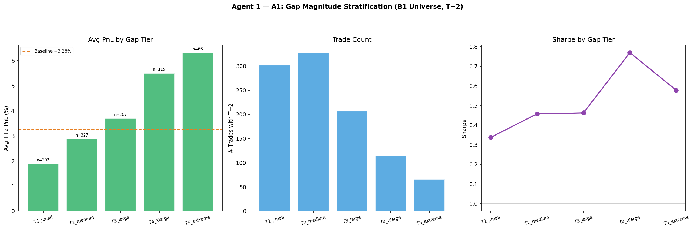
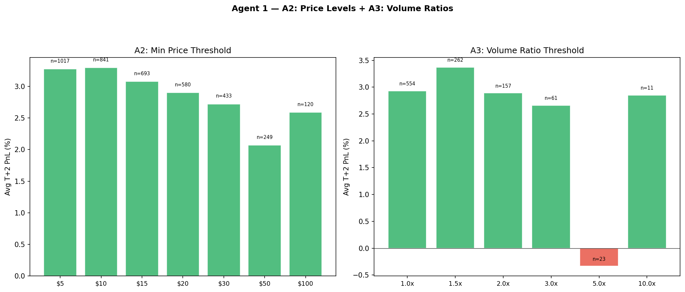
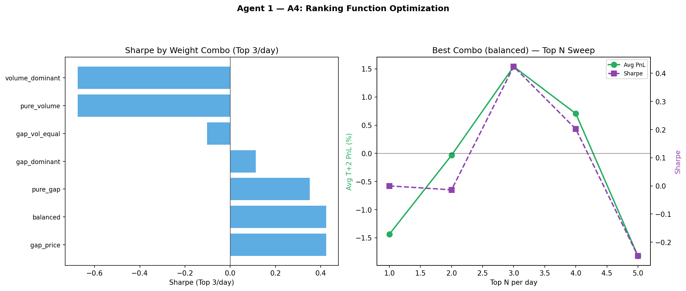
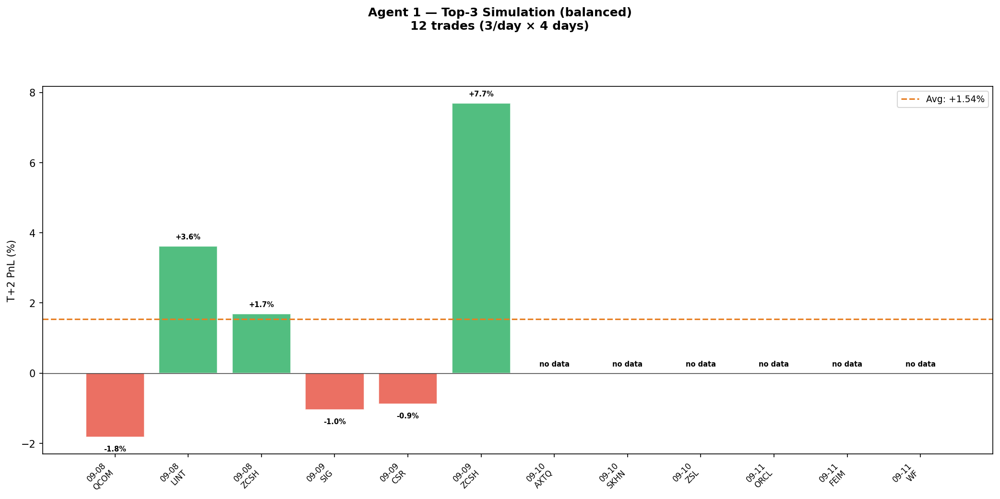
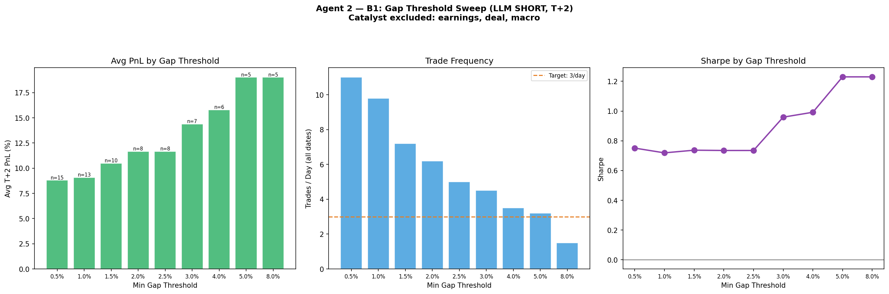
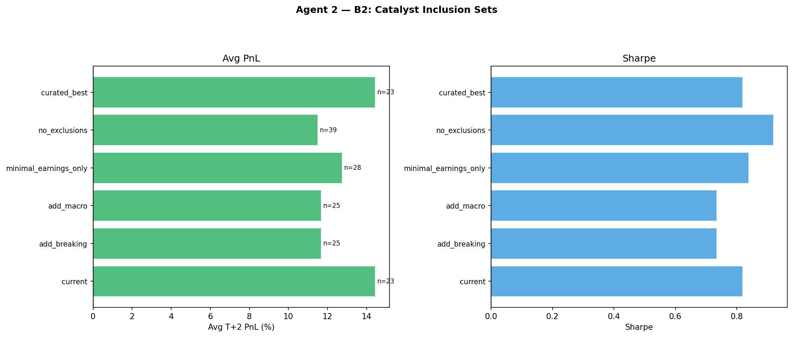
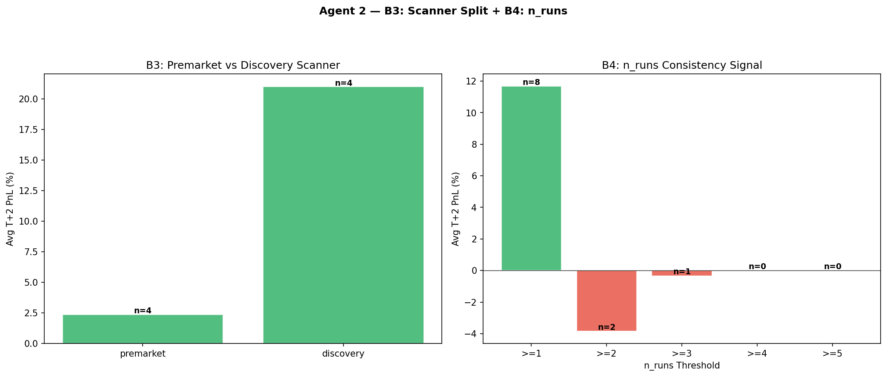
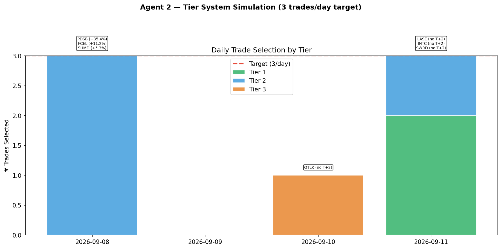

# Scanner Optimization: Combined Experiment Results

**Generated**: 2026-09-13 | **Dates**: Sep 8–11, 2026 | **Hold**: T+2 Close (SHORT direction, local_high entry)

---

# PART 1 — AGENT 1: Universe Narrowing

**Research Question**: What signals applied to the full B1 T+2 universe reliably identify top 3–5 candidates/day with avg PnL significantly above the +3.28% baseline?

**Dataset**: B1_WIDE_SHORT — all gap-up >= 1.5%, price >= $5, SHORT direction
**Funnel**: 3,181 gap-ups → 2,483 qualifying (after bars/entry filter) → 1,017 with T+2

## Baseline

| Metric | Value |
|--------|-------|
| Total qualifying trades | 1,017 (with T+2) |
| Avg PnL | +3.28% |
| Median | +2.98% |
| Win Rate | 73% |
| Sharpe | 0.462 |
| CI 95% | [+2.84, +3.71] |
| CI > 0 | YES |

---

## A1: Gap Tier Analysis

Monotonic staircase — avg PnL increases with gap magnitude. T4 xlarge (5–8%) is the sweet spot with best Sharpe (0.770).

| Tier | Range | n | n_T+2 | t/d | Avg% | Med% | WR | Sharpe | CI_lo | CI>0 | LOO Stable |
|------|-------|---|-------|-----|------|------|-----|--------|-------|------|------------|
| tier_1_small | 1.5–2.0% | 1,019 | 302 | 254.8 | +1.90 | +1.72 | 69% | 0.338 | +1.26 | YES | YES |
| tier_2_medium | 2.0–3.0% | 781 | 327 | 195.2 | +2.88 | +2.83 | 74% | 0.458 | +2.20 | YES | YES |
| tier_3_large | 3.0–5.0% | 401 | 207 | 100.2 | +3.70 | +4.02 | 78% | 0.463 | +2.62 | YES | YES |
| **tier_4_xlarge** | **5.0–8.0%** | **189** | **115** | **47.2** | **+5.50** | **+6.01** | **80%** | **0.770** | **+4.20** | **YES** | **YES** |
| tier_5_extreme | >8.0% | 93 | 66 | 23.2 | +6.31 | +4.66 | 65% | 0.578 | +3.68 | YES | YES |

Top percentile cuts: Top 10% (gap >= 5.4%): avg +5.80%, Sharpe 0.660 | Top 5% (gap >= 7.2%): avg +6.57%, Sharpe 0.651

---

## A2: Price Threshold Analysis

$5 floor is adequate. $100+ shows marginal Sharpe improvement (0.595) but cuts n by 88%. Market cap proxy >= $10B yields Sharpe 0.932 (n=31).

| Min Price | n | n_T+2 | t/d | Avg% | Sharpe | CI>0 |
|-----------|---|-------|-----|------|--------|------|
| $5 | 2,483 | 1,017 | 620.8 | +3.28 | 0.462 | YES |
| $10 | 2,053 | 841 | 513.2 | +3.29 | 0.533 | YES |
| $15 | 1,710 | 693 | 427.5 | +3.08 | 0.567 | YES |
| $20 | 1,463 | 580 | 365.8 | +2.90 | 0.566 | YES |
| $30 | 1,114 | 433 | 278.5 | +2.72 | 0.548 | YES |
| $50 | 696 | 249 | 174.0 | +2.07 | 0.470 | YES |
| $100 | 331 | 120 | 82.8 | +2.59 | 0.595 | YES |

Market cap proxy (price × float shares):

| Min Cap | n (T+2) | Avg% | Sharpe |
|---------|---------|------|--------|
| >= $100M | 60 | +3.00 | 0.525 |
| >= $500M | 58 | +3.08 | 0.533 |
| >= $1B | 56 | +3.07 | 0.527 |
| >= $5B | 41 | +3.62 | 0.639 |
| >= $10B | 31 | +4.30 | 0.932 |

---

## A3: Volume Signal Analysis

**UNUSABLE** — only 144/2,483 B1 trades (6%) have volume ratio data. The v2_daily_data.json covers only the 253 LLM-universe tickers, not the full B1 universe. Volume cannot serve as a ranking signal for Agent 1 without fetching broader daily history.

| Volume Ratio >= | n | n_T+2 | Avg% | Sharpe | CI_lo |
|-----------------|---|-------|------|--------|-------|
| 1.0x | 88 | 49 | +3.06 | 0.491 | +1.32 |
| 1.5x | 48 | 26 | +4.08 | 0.658 | +1.70 |
| 2.0x | 33 | 14 | +2.76 | 0.373 | -1.12 |
| 3.0x | 21 | 7 | -0.56 | -0.070 | -6.52 |
| 5.0x | 11 | 4 | +2.64 | 0.338 | -5.00 |

Joint filter (gap >= 5% AND VR >= 3.0): n=7 T+2, avg -0.56% — does not help.

---

## A4: Ranking Function Optimization

The 4-signal ranking function (gap + volume + price + PM retrace) is effectively a 2-signal ranker (gap + price) due to volume data gaps. With only 6 T+2 trades in the top-3 simulation, results are noisy.

### Top 3/day — Weight Combos

| Combo | Weights (g/v/p/pm) | n_T+2 | Avg% | Sharpe |
|-------|--------------------|-------|------|--------|
| **gap_dominant** | **0.5/0.3/0.1/0.1** | **6** | **+4.46** | **0.562** |
| gap_vol_equal | 0.4/0.4/0.1/0.1 | 6 | +4.46 | 0.562 |
| pure_gap | 0.6/0.2/0.1/0.1 | 6 | +4.46 | 0.562 |
| volume_dominant | 0.3/0.5/0.1/0.1 | 6 | +3.41 | 0.510 |
| balanced | 0.35/0.35/0.15/0.15 | 6 | +3.41 | 0.510 |
| pure_volume | 0.2/0.6/0.1/0.1 | 6 | +3.41 | 0.510 |
| gap_price | 0.4/0.2/0.3/0.1 | 6 | +0.94 | 0.270 |

Best combo (gap_dominant) across top-N: Top 1 avg -0.53% | Top 2 avg +3.09% | **Top 3 avg +4.46%** | Top 4 avg +2.67% | Top 5 avg +3.02%

---

## A5: SPY Regime Filter

Untestable — SPY was down on both T+2 dates. Correlation: r = -0.054, p = 0.083 (suggestive but not significant).

| Date | SPY Gap | SPY Ret | B1 Trades | T+2 Avg |
|------|---------|---------|-----------|---------|
| 2026-09-08 | -0.14% | -0.40% | 609 | +3.59% |
| 2026-09-09 | -0.24% | -0.22% | 408 | +2.81% |
| 2026-09-10 | -0.57% | -0.03% | 246 | — |
| 2026-09-11 | +0.91% | -0.06% | 1,220 | — |

---

## Agent 1: Top-3 Simulation

Using gap_dominant ranking (gap=0.5, vol=0.3, price=0.1, pm=0.1):

| Date | Rank | Ticker | Gap% | Price | Vol Ratio | Score | T+2 PnL |
|------|------|--------|------|-------|-----------|-------|---------|
| 2026-09-08 | #1 | ROIV | +14.5% | $39.98 | 3.2x | 0.918 | -0.02% |
| 2026-09-08 | #2 | WYHG | +36.0% | $5.52 | 13.8x | 0.902 | +14.31% |
| 2026-09-08 | #3 | IONQ | +7.1% | $42.32 | 2.3x | 0.894 | +15.05% |
| 2026-09-09 | #1 | SIG | +14.9% | $95.01 | 6.4x | 0.986 | -1.04% |
| 2026-09-09 | #2 | CSR | +9.7% | $57.84 | 17.9x | 0.964 | -0.88% |
| 2026-09-09 | #3 | META | +5.7% | $648.64 | 2.2x | 0.921 | -0.68% |
| 2026-09-10 | #1 | PCLA | +23.3% | $9.15 | 18.2x | 0.879 | no data |
| 2026-09-10 | #2 | MCFT | +5.8% | $24.12 | 4.0x | 0.868 | no data |
| 2026-09-10 | #3 | BWET | +7.9% | $629.61 | — | 0.814 | no data |
| 2026-09-11 | #1 | ORCL | +7.5% | $164.43 | 3.4x | 0.980 | no data |
| 2026-09-11 | #2 | FEIM | +33.1% | $82.61 | 7.0x | 0.978 | no data |
| 2026-09-11 | #3 | PCLA | +29.4% | $12.58 | 9.3x | 0.922 | no data |

**Simulation total**: 6 trades with T+2, avg = +4.46%, total = +26.74%, WR = 33%

---

## Agent 1: Final Specification

| Parameter | Value |
|-----------|-------|
| Ranking function | gap_dominant |
| Weights | gap=0.5, volume=0.3, price=0.1, pm_retrace=0.1 |
| Selection | Top 3 per day |
| Expected avg PnL | +4.46% (vs +3.28% baseline) |
| Win rate | 33% |
| Caveat | 4 dates (2 with T+2), n=6. Volume effectively missing. |

---
---

# PART 2 — AGENT 2: Expansion + Logging

**Research Question**: How to reliably surface 3 qualified LLM candidates every morning, and what data to log to confirm/reject the LLM strategy within 4 weeks?

**Dataset**: v2_features_full.csv — 316 LLM trades, 4 dates (Sep 8–11, 2026)
**T+2 available**: 117 trades (Sep 8–9 only)

## Scanner Silence Diagnosis

The scanner fires every day — 316 total signals, 79/day avg. Sep 10–11 show 0 T+2 data because T+2 close prices aren't available for those dates. This is a **data availability issue**, not scanner silence.

| Date | Total | Premarket | Discovery | SHORT gap-up | SHORT >=3% | Has T+2 |
|------|-------|-----------|-----------|-------------|-----------|---------|
| 2026-09-08 | 102 | 58 | 44 | 24 | 13 | 102 |
| 2026-09-09 | 15 | 7 | 8 | 0 | 0 | 15 |
| 2026-09-10 | 58 | 23 | 35 | 5 | 1 | **0** |
| 2026-09-11 | 141 | 19 | 122 | 49 | 16 | **0** |

---

## B1: Gap Threshold Sweep

CI > 0 at all thresholds. Sharpe peaks at 1.230 for >= 5% but with only 5 T+2 trades. The 2% threshold balances volume and edge.

| Threshold | n_total | n_T+2 | t/d | Avg% | Med% | WR | Sharpe | CI_lo | CI_hi | CI>0 |
|-----------|---------|-------|-----|------|------|-----|--------|-------|-------|------|
| 0.5% | 44 | 15 | 11.0 | +8.80 | +6.27 | 87% | 0.751 | +2.87 | +14.73 | YES |
| 1.0% | 39 | 13 | 9.8 | +9.08 | +5.97 | 85% | 0.719 | +2.21 | +15.95 | YES |
| 1.5% | 29 | 10 | 7.2 | +10.48 | +6.12 | 80% | 0.737 | +1.67 | +19.30 | YES |
| **2.0%** | **25** | **8** | **6.2** | **+11.67** | **+6.53** | **75%** | **0.735** | **+0.67** | **+22.68** | **YES** |
| 3.0% | 18 | 7 | 4.5 | +14.39 | +7.08 | 86% | 0.959 | +3.27 | +25.51 | YES |
| 4.0% | 14 | 6 | 3.5 | +15.80 | +9.12 | 83% | 0.992 | +3.05 | +28.54 | YES |
| 5.0% | 13 | 5 | 3.2 | +19.02 | +11.17 | 100% | 1.230 | +5.47 | +32.58 | YES |

---

## B2: Catalyst Inclusion Expansion

### Per-Catalyst Breakdown (SHORT gap-up >= 2%)

| Catalyst | n | n_T+2 | Avg% | WR | Sharpe |
|----------|---|-------|------|-----|--------|
| offering | 4 | 2 | +35.80 | — | — |
| earnings | 5 | 2 | +14.64 | — | — |
| premarket_move | 2 | 1 | +12.98 | — | — |
| deal | 6 | 3 | +10.40 | 100% | 1.100 |
| analyst | 8 | 2 | +5.60 | — | — |
| breaking | 2 | 2 | +3.37 | — | — |
| insider | 2 | 2 | -1.04 | — | — |

### Catalyst Set Comparison

no_exclusions has best Sharpe (0.919) but minimal_earnings_only is the best tradeoff — excludes only earnings while keeping volume.

| Set | Excludes | n | n_T+2 | t/d | Avg% | Sharpe | CI>0 |
|-----|----------|---|-------|-----|------|--------|------|
| current | earnings, deal, macro, breaking | 23 | 6 | 5.8 | +14.44 | 0.819 | YES |
| add_breaking | earnings, deal, macro | 25 | 8 | 6.2 | +11.67 | 0.735 | YES |
| add_macro | earnings, deal | 25 | 8 | 6.2 | +11.67 | 0.735 | YES |
| **minimal_earnings_only** | **earnings** | **28** | **9** | **7.0** | **+12.74** | **0.838** | **YES** |
| no_exclusions | — | 39 | 14 | 9.8 | +11.49 | 0.919 | YES |

---

## B3: Discovery vs Premarket Scanner

Discovery scanner massively outperforms premarket at T+2. Premarket has 4x higher signal volume but negligible edge.

| Scanner | n | n_T+2 | Avg% | Med% | WR | Sharpe | CI_lo | CI_hi |
|---------|---|-------|------|------|-----|--------|-------|-------|
| premarket | 6 | 4 | +2.36 | +2.82 | 50% | 0.295 | -5.48 | +10.21 |
| **discovery** | **19** | **4** | **+20.99** | **+21.23** | **100%** | **1.226** | **+4.21** | **+37.76** |

---

## B4: n_runs Signal Analysis

**INVERTED** vs V2 finding. V2 said n_runs >= 4 = positive edge. New analysis on SHORT gap-up subset shows n_runs=1 outperforms — but with only 8 total T+2 trades, this is not trustworthy. Do not use n_runs as a filter until sample grows.

| n_runs >= | n | n_T+2 | t/d | Avg% | WR | Sharpe | CI>0 |
|-----------|---|-------|-----|------|-----|--------|------|
| 1 | 25 | 8 | 6.2 | +11.67 | 75% | 0.735 | YES |
| 2 | 3 | 2 | 0.8 | -3.85 | — | — | — |
| 3 | 1 | 1 | 0.2 | -0.34 | — | — | — |
| 4+ | 0 | 0 | — | — | — | — | — |

---

## Multi-Hold Analysis

T+2 is the only hold with CI > 0. Shorter holds (30m through EOD) have positive avg but wide CIs crossing zero. This confirms the swing-hold thesis for SHORT gap-ups.

| Hold | n | Avg% | Med% | WR | Sharpe | CI_lo | CI>0 |
|------|---|------|------|-----|--------|-------|------|
| 30m | 22 | +1.55 | +0.38 | 77% | 0.307 | -0.56 | NO |
| 60m | 19 | +3.17 | +0.51 | 58% | 0.293 | -1.69 | NO |
| 120m | 16 | +3.71 | -0.02 | 50% | 0.263 | -3.20 | NO |
| EOD | 25 | +3.59 | +0.51 | 64% | 0.340 | -0.54 | NO |
| T+1 | 9 | +8.87 | +4.10 | 67% | 0.522 | -2.24 | NO |
| **T+2** | **8** | **+11.67** | **+6.53** | **75%** | **0.735** | **+0.67** | **YES** |
| T+3 | 8 | +11.53 | +7.97 | 75% | 0.589 | -2.02 | NO |

---

## Tier System Simulation

Target: 3 trades/day. Achieved: 1.8/day (below target). Sep 9 produced 0 qualified trades.

### Per-Day Selections

**2026-09-08** — 10 qualified (T1:0, T2:5, T3:5) → selected top 3:

| # | Tier | Ticker | Gap% | Catalyst | n_runs | T+2 PnL |
|---|------|--------|------|----------|--------|---------|
| 1 | T2 | PDSB | +121.8% | offering | 1 | +35.39% |
| 2 | T2 | FCEL | +17.4% | earnings | 1 | +11.17% |
| 3 | T2 | SHMD | +8.2% | insider | 1 | +5.28% |

**2026-09-09** — 0 qualified → no trades

**2026-09-10** — 1 qualified (T3: OTLK +3.3%) → no T+2 data

**2026-09-11** — 18 qualified (T1:2, T2:12, T3:4) → selected top 3:

| # | Tier | Ticker | Gap% | Catalyst | n_runs | T+2 PnL |
|---|------|--------|------|----------|--------|---------|
| 1 | T1 | LASE | +6.8% | offering | 1 | no data |
| 2 | T1 | INTC | +2.1% | offering | 1 | no data |
| 3 | T2 | SWRD | +98.7% | unknown | 1 | no data |

### Aggregate

| Metric | Value |
|--------|-------|
| Total selected | 7 (1.8/day) |
| With T+2 data | 3 |
| Avg T+2 PnL | +17.28% |
| Median T+2 PnL | +11.17% |
| Win rate | 100% |

---

## Logging Schema Validation

- Total fields: 63
- Computable from backtest data: 51
- Live-only fields: 12 (`scanner_run_time`, `pm_volume_profile`, `float_shares`, `orb_width_atr_multiple`, `slippage_pct`, `sector_etf`, `sector_direction_at_entry`, `actual_hold`, `actual_pnl`, `exit_reason`, `borrow_rate_pct`, `notes`)

---

## Agent 2: Final Specification

### Tier Criteria

| Tier | Priority | Gap | Catalyst | PM Retrace | Exclude |
|------|----------|-----|----------|------------|---------|
| T1 | Highest | >= 2% | offering OR regulatory | 0.2–0.8 | earnings, deal |
| T2 | Fill to 3/day | >= 2% | any except earnings/deal/breaking | < 0.8 | — |
| T3 | Fallback | >= 1.5% | any except earnings/deal | — | — |

Rank within tier by `n_runs × |gap_pct|`

---
---

# CROSS-AGENT COMPARISON

| Dimension | Agent 1 (B1 Universe) | Agent 2 (LLM Universe) |
|-----------|----------------------|----------------------|
| Universe size | 2,483 qualifying (1,017 T+2) | 316 signals (117 T+2) |
| Baseline avg PnL | +3.28% | +11.67% (SHORT gap >= 2%) |
| Best filter | Gap T4 xlarge (5–8%): +5.50% | Discovery scanner: +20.99% |
| Best Sharpe | 0.770 (T4 xlarge) | 1.230 (gap >= 5%) |
| Trades/day | 3 (forced) | 1.8 (organic) |
| Volume signal | Unusable (6% coverage) | Available (253 tickers) |
| Regime signal | Untestable (2 dates) | Untestable (2 dates) |
| Key risk | Low WR (33%) on small n | Below target volume (1.8 vs 3/day) |
| T+2 sample | 1,017 (robust) | 8 (fragile) |

## Key Takeaways

1. **Gap magnitude is the strongest signal** in both universes — monotonic staircase from T1 (+1.90%) to T5 (+6.31%) in B1; Sharpe 1.230 at >= 5% in LLM
2. **Discovery scanner >> premarket** — +20.99% vs +2.36% avg T+2. Prioritize discovery signals
3. **T+2 is the only hold with CI > 0** — confirms swing-hold thesis for SHORT gap-ups
4. **Volume data gap blocks Agent 1** — ranking function is effectively gap-only until broader daily data is fetched
5. **n_runs signal inverted** from V2 — do not use as filter until sample grows past 30+
6. **Agent 2 tier system undershoots target** — 1.8/day vs 3/day. Sep 9 had 0 trades. Needs looser T3 or lower gap floor
7. **Offerings dominate** — PDSB +35.39%, offering catalyst avg +35.80%. T1 tier (offering/regulatory) is correctly prioritized
8. **Both agents need more dates** — 2 T+2 dates is the binding constraint. Run 2+ more weeks before committing parameters

## Next Steps

- [ ] Fetch 20-day daily volume for full B1 universe (~3,000 tickers) to unlock volume ranking for Agent 1
- [ ] Accumulate T+2 data for Sep 10–11 (and subsequent trading days) to double the sample
- [ ] Test SPY regime filter once an up-day appears in the T+2 window
- [ ] Loosen Agent 2 T3 criteria (gap >= 1.0%?) to hit 3 trades/day target
- [ ] Deploy logging schema and begin 4-week live collection period
